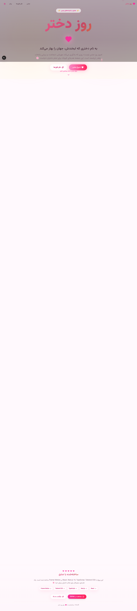

# 🌸 روز دختر | Girl's Day

> یک تجربه‌ی دیجیتال زیبا و احساسی برای بزرگداشت **روز دختر** — ساخته‌شده با Next.js، React، TypeScript، Tailwind CSS و Framer Motion.



## ✨ ویژگی‌ها

- 🎆 **افکت آتش‌بازی زنده** — آتش‌بازی‌های انیمیشنی روی Canvas
- 🌸 **قلب‌ها و گل‌های پرنده** — ذرات شناور با حال‌وهوای رمانتیک
- 🎂 **کیک و شمع تعاملی** — شمع‌ها را فوت کن و آرزو کن
- 💬 **نقل قول‌های الهام‌بخش** — جملاتی از زنان بزرگ و نویسندگان
- 🎵 **موزیک پلیر زیبا** — با اکولایزر انیمیشنی و گرافیک چرخان
- 💌 **فرم پیام تبریک** — بنویس و بفرست
- 📚 **بخش تاریخچه روز دختر** — آگاهی‌بخشی درباره‌ی اهمیت این روز
- 🌗 **حالت تاریک/روشن** — با toggle انیمیشنی
- 📱 **کاملاً ریسپانسیو** — موبایل، تبلت و دسکتاپ
- 🇮🇷 **راست‌چین (RTL)** — فارسی با فونت Vazirmatn
- ⚡ **انیمیشن‌های نرم** — با Framer Motion

## 🛠 تکنولوژی‌ها

| لایه | تکنولوژی |
|------|----------|
| Framework | Next.js 16 (App Router) |
| Language | TypeScript 5 |
| UI | React 19 + Tailwind CSS 4 |
| Components | shadcn/ui |
| Animation | Framer Motion |
| Icons | Lucide React |
| Font | Vazirmatn (فارسی) |

## 🚀 اجرای محلی

### پیش‌نیازها
- [Node.js](https://nodejs.org/) 18+ یا [Bun](https://bun.sh/) 1.0+

### نصب و اجرا

```bash
# با Bun (پیشنهادی)
bun install
bun run dev

# یا با npm
npm install
npm run dev

# یا با pnpm
pnpm install
pnpm dev
```

سپس به آدرس [http://localhost:3000](http://localhost:3000) بروید.

## 📦 ساخت پروژه

```bash
bun run build
# خروجی در پوشه‌ی .next/standalone ذخیره می‌شود
```

## 🌐 Deployment

این پروژه به‌صورت خودکار برای deploy روی **GitHub Pages** و **Vercel** آماده شده است.

### گزینه ۱: Vercel (ساده‌ترین روش)

1. حساب کاربری در [vercel.com](https://vercel.com) بسازید
2. مخزن GitHub خود را به Vercel متصل کنید
3. Vercel به‌صورت خودکار تنظیمات را از `vercel.json` می‌خواند
4. Deploy کنید! 🎉

```bash
# یا با CLI
npm install -g vercel
vercel
```

### گزینه ۲: GitHub Pages

تنظیمات `next.config.ts` به‌صورت خودکار `basePath` را بر اساس نام مخزن شما تنظیم می‌کند. نیازی به تغییر دستی نیست.

1. کد را به GitHub push کنید:

```bash
git init
git add .
git commit -m "🌸 initial commit: Girls Day project"
git branch -M main
git remote add origin https://github.com/USERNAME/REPO-NAME.git
git push -u origin main
```

2. در GitHub به مسیر **Settings → Pages** بروید
3. در بخش **Source** گزینه‌ی **GitHub Actions** را انتخاب کنید
4. Workflow در `.github/workflows/deploy.yml` به‌صورت خودکار اجرا می‌شود
5. پس از چند دقیقه، سایت شما در آدرس زیر در دسترس خواهد بود:

```
https://USERNAME.github.io/REPO-NAME/
```

> 💡 **نکته:** برای deploy با دامنه‌ی سفارشی، `basePath` را در `next.config.ts` خالی بگذارید.

## 📁 ساختار پروژه

```
.
├── .github/workflows/
│   ├── deploy.yml              # GitHub Pages workflow
│   └── deploy-vercel.yml       # Vercel workflow
├── public/                     # فایل‌های استاتیک
├── src/
│   ├── app/
│   │   ├── globals.css         # استایل سراسری + افکت‌ها
│   │   ├── layout.tsx          # RTL، فونت فارسی، metadata
│   │   └── page.tsx            # صفحه‌ی اصلی
│   ├── components/
│   │   ├── ui/                 # shadcn/ui components
│   │   └── girls-day/
│   │       ├── navbar.tsx              # نوار ناوبری
│   │       ├── hero.tsx                # بخش هیرو
│   │       ├── floating-elements.tsx   # قلب و گل پرنده
│   │       ├── fireworks.tsx           # آتش‌بازی Canvas
│   │       ├── quotes.tsx              # نقل قول‌ها
│   │       ├── cake.tsx                # کیک تعاملی
│   │       ├── music-player.tsx        # موزیک پلیر
│   │       ├── message-section.tsx     # فرم پیام
│   │       ├── history-section.tsx     # تاریخچه روز دختر
│   │       └── footer.tsx              # فوتر
│   └── lib/
│       └── utils.ts            # ابزارهای کمکی
├── next.config.ts              # تنظیمات Next.js + basePath
├── vercel.json                 # تنظیمات Vercel
├── tailwind.config.ts          # تنظیمات Tailwind
└── package.json
```

## 🎨 شخصی‌سازی

### تغییر رنگ‌ها

پالت رنگ در فایل `src/app/globals.css` متغیرهای CSS تعریف شده. برای تغییر پالت، مقادیر oklch در `:root` و `.dark` را ویرایش کنید.

### افزودن نقل قول

آرایه‌ی `QUOTES` در `src/components/girls-day/quotes.tsx` را ویرایش کنید.

### افزودن آهنگ واقعی

در `src/components/girls-day/music-player.tsx` یک تگ `<audio>` اضافه کنید و آن را به state `playing` متصل کنید. فایل صوتی را در `public/` قرار دهید.

### تغییر نام دختر

در `src/components/girls-day/hero.tsx` متن تیتر را به دلخواه ویرایش کنید.

## 📜 درباره‌ی روز دختر

روز دختر بین‌المللی (**International Day of the Girl Child**) هر ساله در **۱۱ اکتبر** برگزار می‌شود و از سال ۲۰۱۲ توسط سازمان ملل متحد تصویب شده است. هدف این روز، افزایش آگاهی درباره‌ی چالش‌هایی است که دختران در سراسر جهان با آن مواجه‌اند و ترویج برابری فرصت‌ها برای رشد و توانمندسازی آن‌هاست.

## 📄 لایسنس

MIT License — آزاد برای استفاده و تغییر.

---

<p align="center">
  ساخته‌شده با ❤️ برای تمام دخترانِ زیبای دنیا
</p>
